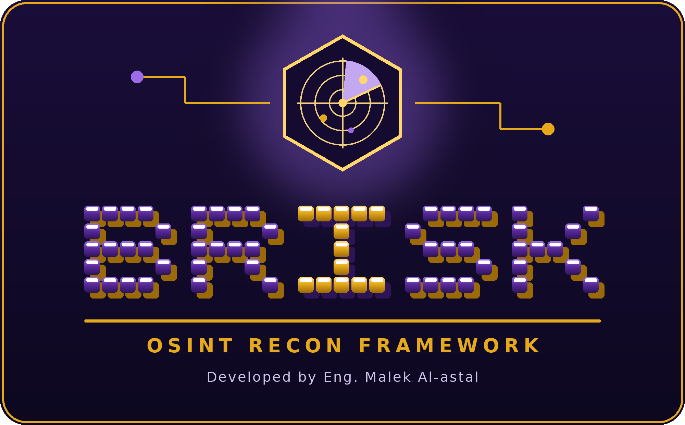

<div align="center">



# BRISK INTELLIGENCE ECOSYSTEM

### OSINT RECONNAISSANCE • ARTIFICIAL INTELLIGENCE • CYBERSECURITY

**Two powerful tools. One intelligence vision.**

<p>
  
  
</p>

<p>
  
  
  
  
</p>

**Developed by Eng. Malek Al-astal | TechNova**

[Repository](https://github.com/msecurity404/BRISK-OSINT) •
[Report an Issue](https://github.com/msecurity404/BRISK-OSINT/issues)

</div>

---

# 01. About BRISK

**BRISK** is a cybersecurity and intelligence ecosystem built around two complementary command-line tools:

- **BRISK OSINT:** An open-source intelligence and external attack-surface reconnaissance framework.
- **BRISK AI:** An interactive AI terminal assistant powered by Google's Gemini API.

Together, they provide a practical environment for digital footprint discovery, security research, information analysis, and AI-assisted productivity.

> Discover the footprint. Understand the data. Think smarter.

## 02. Meet the Tools

### BRISK OSINT — Intelligence & Reconnaissance

BRISK OSINT helps security researchers investigate publicly accessible information about domains, organizations, websites, and internet-facing infrastructure.

**Core capabilities:**

- Domain intelligence and WHOIS/RDAP.
- DNS records and infrastructure discovery.
- Subdomain enumeration.
- Email security analysis.
- Website technology fingerprinting.
- HTTP security headers and TLS information.
- Look-alike domain and typosquatting checks.
- Historical URL intelligence.
- GitHub organization and public code intelligence.
- Brand handle discovery.
- Public breach catalogue checks.
- IP and infrastructure intelligence.
- Document metadata analysis.
- Risk indicators and scan history comparison.
- HTML, JSON, and Markdown reports.

### BRISK AI — Your Terminal AI Assistant

BRISK AI is an interactive terminal assistant powered by the Gemini API.

**Features:**

- Interactive terminal conversation.
- Multilingual communication.
- AI-assisted explanations and research.
- Model selection.
- Conversation reset.
- Export conversation to a file.
- API key configuration.
- Streaming responses.

BRISK AI requires a valid Gemini API key.

**Important:** BRISK AI is currently distributed separately from this BRISK OSINT repository. Its command is available on systems where BRISK AI has been installed and configured.

---

# 03. Installation

## Requirements

- Android with Termux, or a Linux environment.
- Python 3.9 or newer.
- Git.
- Internet connection.
- Gemini API key for BRISK AI.

## Install BRISK OSINT

### Termux

```bash
pkg update -y && pkg upgrade -y
pkg install python git -y
```

Clone the repository:

```bash
git clone https://github.com/msecurity404/BRISK-OSINT.git
cd BRISK-OSINT
```

Install the framework:

```bash
python -m pip install --upgrade pip
python -m pip install -e ".[fast]"
```

If you do not need the optional DNS dependency:

```bash
python -m pip install -e .
```

### Linux

```bash
git clone https://github.com/msecurity404/BRISK-OSINT.git
cd BRISK-OSINT

python3 -m pip install -e ".[fast]"
```

---

# 04. Launch BRISK

## Start BRISK OSINT Interface

Launch the interactive OSINT menu:

```bash
python -m brisk_osint
```

Or, after installation:

```bash
brisk-osint
```

The interactive interface provides access to the available reconnaissance features.

## Start BRISK AI Interface

On a device where BRISK AI is installed:

```bash
brisk
```

First-time setup:

```bash
brisk --setup
```

Follow the prompts to configure your Gemini API key.

Check available options:

```bash
brisk -h
```

Select a model:

```bash
brisk -m MODEL_NAME
```

Start without animation:

```bash
brisk --no-anim
```

Display version information:

```bash
brisk -v
```

**BRISK AI installation note:** The BRISK AI executable is not included in this repository yet. The command above applies after its separate installation.

---

# 05. BRISK OSINT — Usage Guide

## Full Domain Scan

```bash
brisk-osint example.com
```

Use a domain you own or are authorized to assess.

## Quick Scan

```bash
brisk-osint example.com -p quick
```

## Select Modules

```bash
brisk-osint example.com -m subdomains,typosquat
```

## Passive Reconnaissance

```bash
brisk-osint example.com --passive
```

## Active Checks

```bash
brisk-osint example.com --active
```

Active checks may probe exposed paths. Use them only within an authorized assessment scope.

## Multiple Domains

```bash
brisk-osint example.com example.org
```

## IP Intelligence

```bash
brisk-osint --ip 8.8.8.8
```

## Metadata Analysis

```bash
brisk-osint --metadata ./documents
```

## Scan History

```bash
brisk-osint --history
```

## List Available Modules

```bash
brisk-osint --list-modules
```

## Help

```bash
brisk-osint --help
```

---

# 06. BRISK AI — Interactive Commands

Start the assistant:

```bash
brisk
```

Available interactive commands:

| Command | Function |
|---|---|
| `/help` | Display help |
| `/clear` | Reset conversation |
| `/model NAME` | Switch AI model |
| `/save FILE` | Export conversation |
| `/key` | Configure API key |
| `/exit` | Exit assistant |

BRISK AI uses Google's Gemini API. Availability and model access depend on the configured API key and Google's service.

---

# 07. Reports & Results

BRISK OSINT creates structured reports for each scan.

Default report directory:

```text
brisk-reports/
```

Typical report structure:

```text
brisk-reports/
└── example.com_TIMESTAMP/
    ├── report.html
    ├── report.json
    └── report.md
```

| Format | Description |
|---|---|
| HTML | Browser-readable security report |
| JSON | Structured data for automation |
| Markdown | Human-readable report |

Choose output formats:

```bash
brisk-osint example.com -f html
```

```bash
brisk-osint example.com -f json,md
```

Choose output directory:

```bash
brisk-osint example.com -o reports/
```

BRISK OSINT also supports scan history and comparison with previous results.

---

# 08. Configuration & API Keys

## BRISK OSINT

Basic functionality does not require API keys.

Optional integrations:

**GitHub Token**

```bash
export GITHUB_TOKEN="YOUR_GITHUB_TOKEN"
```

**Shodan API Key**

```bash
export SHODAN_API_KEY="YOUR_SHODAN_API_KEY"
```

These integrations can provide additional intelligence where supported by the corresponding modules.

## BRISK AI

BRISK AI requires a Gemini API key.

Configure it through:

```bash
brisk --setup
```

Never publish API keys, passwords, or private configuration files.

---

# 09. Project Structure

```text
BRISK-OSINT/
│
├── assets/
│   ├── logo.png
│   └── logo.svg
│
├── brisk_osint/
│   ├── modules/
│   ├── cli.py
│   ├── core.py
│   ├── report.py
│   ├── history.py
│   ├── ipintel.py
│   ├── dnsutil.py
│   ├── branding.py
│   └── ui.py
│
├── tests/
├── tools/
├── .gitignore
├── pyproject.toml
├── requirements.txt
└── README.md
```

---

# 10. Development & Testing

Run offline tests:

```bash
python -m unittest discover -s tests
```

Install in editable mode for development:

```bash
python -m pip install -e .
```

---

# 11. Responsible Use

BRISK is intended for authorized security research, defensive reconnaissance, and educational purposes.

- Only assess systems you own or have explicit permission to test.
- Respect privacy, applicable laws, and third-party service terms.
- Do not use active checks outside an authorized scope.
- Verify findings before treating them as confirmed vulnerabilities.
- Do not use the tools to access, disrupt, or damage systems without authorization.

The developer assumes no responsibility for unauthorized or unlawful use.

---

# 12. Credits & Contact

**Eng. Malek Al-astal**  
Founder & CEO — TechNova  
Cybersecurity & Information Security Engineering

GitHub: [@msecurity404](https://github.com/msecurity404)

Project repository:

https://github.com/msecurity404/BRISK-OSINT

---

<div align="center">

# BRISK

### INTELLIGENCE. VISIBILITY. SECURITY.

**Powered by TechNova**

</div>
